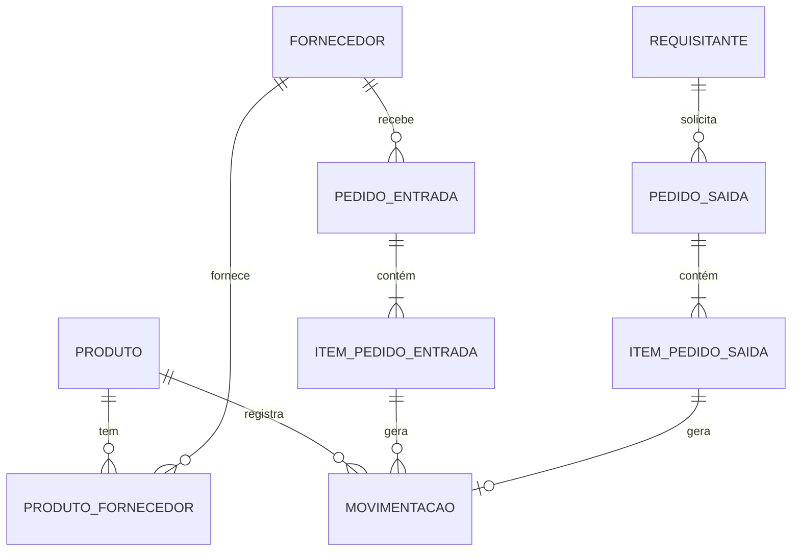

.env para armazenar informacoes do banco de dados

# Arquitetura

## Visão geral
Back (Node + Express + Prisma) → PostgreSQL 16 (Docker). Front consome a API REST.

## Modelo de dados

## Decisões de banco de dados

### 1. Movimentação como livro-razão
- **Decisão:** o saldo vem de uma tabela de movimentações imutável; correções são feitas com ESTORNO.
- **Motivo:** histórico completo, auditoria e base para calcular consumo médio.
- **Descartado:** campo `quantidade` editável no produto (perde histórico e permite inconsistência).
- **Consequência:** nunca há UPDATE/DELETE em movimentações (bloqueado por trigger).

### 2. Saldo em cache mantido por trigger
- **Decisão:** `produtos.saldo_atual` é atualizado por trigger a cada movimentação.
- **Motivo:** listagens rápidas (sem SUM a cada consulta) e proteção contra corrida entre saídas simultâneas.
- **Consequência:** a aplicação não escreve no saldo; `CHECK (saldo_atual >= 0)` impede saldo negativo.

### 3. Prazo de entrega em Produto × Fornecedor (N:N)
- **Motivo:** o mesmo produto tem prazos diferentes por fornecedor.

### 4. Integridade no banco (CHECK, FK Restrict)
- **Motivo:** o banco barra dados inválidos mesmo se a API tiver bug.

### 5. Índices
| Índice | Consulta que atende |
|---|---|
| (produto_id, tipo, data DESC) | consumo médio, última entrada/saída |
| GIN trigram em nome/código | autocompletar na saída |
| parcial (abaixo do ponto) | semáforo vermelho |
| BRIN em data_movimento | tabela append-only |

### 6. Views para o diferencial
- `vw_sugestao_reposicao`: consumo médio × prazo + segurança, descontando o que já está a caminho.
- `vw_estoque_situacao`: semáforo, tempo no estoque, itens parados.

### 7. Tipos e convenções
- Decimal(12,3) para quantidades, snake_case no banco, Timestamptz nas datas.

## Uso de IA
Prompts, iterações e critérios de aceite: ver `DOCUMENTACAO_IA.md`.