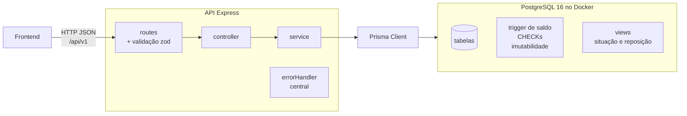
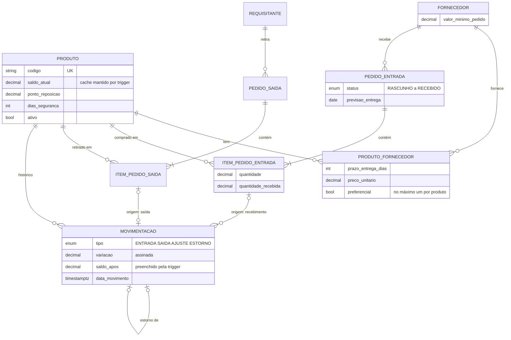
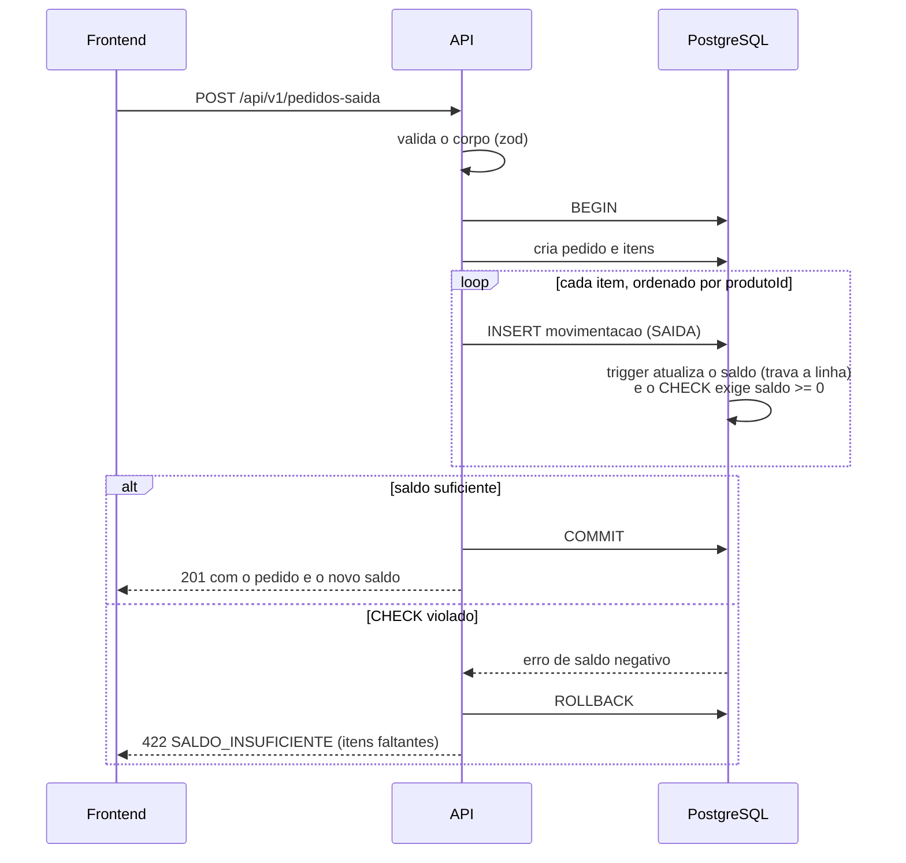
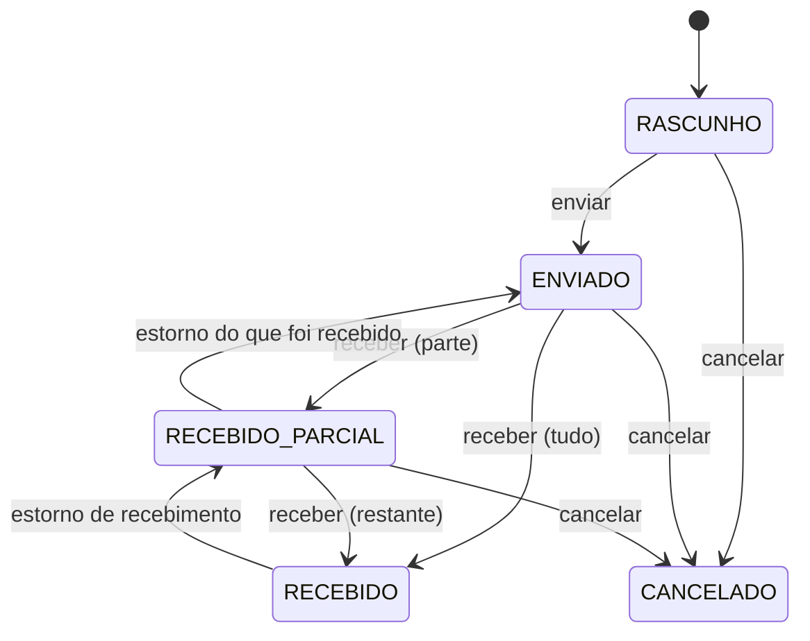

# Arquitetura — Sistema de Estoque

> Este documento explica **o que o sistema é e por que foi desenhado assim**.
> O histórico de uso da IA (prompts, erros e correções) está em [`DOCUMENTACAO_IA.md`](../DOCUMENTACAO_IA.md).
> Os diagramas usam [Mermaid](https://mermaid.js.org/), que o GitHub renderiza automaticamente.

## 1. Visão geral

Sistema de controle de estoque de **um único local**, com cadastro de produtos e fornecedores, pedidos de entrada (compra e recebimento), pedidos de saída (retirada por um requisitante) e histórico completo de movimentações.

**Diferencial: reposição inteligente.** Em vez de depender de um ponto de reposição digitado à mão, o sistema calcula o consumo médio de cada produto, cruza com o prazo de entrega do fornecedor e lista **"o que comprar hoje"**, agrupado por fornecedor, com um botão que gera o pedido de entrada já preenchido. O sistema avisa *antes* de faltar.

**Escopo do MVP**

| Núcleo (obrigatório) | Diferencial | Se sobrar tempo |
|---|---|---|
| CRUD de produtos, fornecedores e requisitantes; pedido de entrada com recebimento; pedido de saída; saldo calculado | Tela "O que comprar hoje" com sugestão de reposição | Semáforo de estoque, itens parados, importação CSV |

## 2. Stack e execução local

| Camada | Tecnologia |
|---|---|
| Frontend | `[PREENCHER: tecnologia do front]` (pasta `web/`) |
| API | Node.js 22–24, Express 5, TypeScript (executado com `tsx`; `nodemon` em desenvolvimento) |
| Validação | zod |
| Acesso a dados | Prisma ORM 7 (adapter `pg`) |
| Banco | PostgreSQL 16 via Docker Compose |

Versões exigidas pela disciplina: Node.js entre 22.x e 24.x; PostgreSQL entre 15 e 16 (usado: 16, imagem `postgres:16-alpine`).

**Subir o ambiente** (detalhes no README):

```bash
cp .env.example .env && cp back/.env.example back/.env   # ajustar a senha nos dois
docker compose up -d
cd back && npm install && npx prisma migrate deploy
npm run dev
```

O `docker-compose.yml` fica na **raiz** do repositório. Há dois `.env`: o da raiz é lido pelo Compose (cria o banco) e o de `back/` é lido pela API e pelo Prisma (`DATABASE_URL`). A senha e a porta precisam coincidir. Os arquivos `.env` ficam fora do Git; apenas os `.env.example`, com valores fictícios, são versionados.

## 3. Arquitetura em camadas



Responsabilidades de cada camada, em cada módulo (`produtos`, `fornecedores`, `requisitantes`, `pedidos-entrada`, `pedidos-saida`, `movimentacoes`, `estoque`, `reposicao`):

| Arquivo | Responsabilidade |
|---|---|
| `*.routes.ts` | Mapeia método + caminho e encadeia a validação |
| `*.schemas.ts` | Contratos de entrada (zod) e tipos derivados |
| `*.controller.ts` | Camada HTTP: lê a requisição validada, chama o service, define o status |
| `*.service.ts` | Regras de negócio e acesso ao banco; não conhece `req`/`res` |

Código transversal em `middlewares/` (`validate`, `errorHandler`, `notFound`), `shared/` (erro de negócio, decimais, paginação) e `lib/prisma.ts`.

## 4. Modelo de dados



Principais escolhas de modelagem:

- **Pedido com cabeçalho e itens**, tanto na entrada quanto na saída. Quantidade, produto e marca pertencem ao item, não ao pedido.
- **Fornecedor × Produto é N:N** (`ProdutoFornecedor`), e o **prazo de entrega e o preço pertencem a essa relação**: o mesmo produto pode levar 3 dias num fornecedor e 10 em outro.
- **"Tempo no estoque" é derivado** (hoje menos a data da última entrada). É calculado na consulta, nunca armazenado, para não ficar desatualizado.
- **Marca como texto** no MVP; **valor mínimo de compra** no Fornecedor.
- **Quantidades** em `Decimal(12,3)` (aceita kg, m, L) e valores em `Decimal(12,2)`. Datas em `timestamptz`. Tabelas e colunas em `snake_case` no banco, mapeadas no Prisma.
- Relações com **`onDelete: Restrict`** onde há histórico a proteger: um pedido com movimentações não é excluído, é cancelado.

## 5. Decisões de arquitetura

Cada decisão segue o formato: contexto, decisão, alternativa descartada, consequência.

### D1. O saldo é derivado de um livro-razão de movimentações

- **Contexto:** o saldo precisa ser confiável e auditável.
- **Decisão:** toda mudança de estoque é uma linha em `movimentacoes` (ENTRADA, SAIDA, AJUSTE ou ESTORNO). A movimentação é a **fonte da verdade**; `produtos.saldo_atual` é um cache atualizado por trigger, e a aplicação **nunca** o escreve (a API rejeita o campo com erro 400).
- **Descartado:** campo "quantidade" editável no produto, que perde o histórico e permite inconsistência.
- **Consequência:** auditoria completa (cada linha guarda `saldo_apos`) e correções somente por **estorno** (nova linha de sinal oposto apontando para a original).

### D2. A integridade é garantida pelo banco, não só pela API

- **Contexto:** a API pode ter bugs ou ser chamada por mais de um cliente; o banco é o último ponto de defesa.
- **Decisão:**
  - **Trigger** `BEFORE INSERT` em `movimentacoes` aplica a variação ao saldo.
  - **CHECKs**: saldo, quantidades e prazos não negativos; sinal coerente com o tipo (ENTRADA > 0, SAIDA < 0); ESTORNO sempre referencia a original; uma movimentação não pode vir de entrada e saída ao mesmo tempo.
  - **Imutabilidade:** `UPDATE` e `DELETE` em movimentações são bloqueados por trigger.
  - **Índice único parcial:** no máximo um fornecedor preferencial por produto.
- **Descartado:** validar apenas na API. Qualquer bug, script ou segundo cliente poderia gravar dados inválidos sem que o banco reagisse.
- **Consequência:** nenhum caminho consegue gerar saldo negativo ou alterar o histórico. Esses recursos não existem no `schema.prisma`, então vivem em `prisma/extras.sql`, aplicado como uma segunda migração versionada.

### D3. Concorrência e transações

- **Contexto:** duas retiradas do mesmo produto podem chegar ao mesmo tempo.
- **Decisão:** o `UPDATE` da trigger **trava a linha do produto**, serializando as operações, e o CHECK impede o saldo negativo. Toda operação que gera movimentação roda em `prisma.$transaction` (pedido, itens e movimentações entram juntos ou não entram). Os itens são processados em **ordem fixa por `produtoId`**, para que duas transações com produtos em ordens diferentes não travem uma à outra (deadlock).
- **Descartado:** consultar o saldo na API e só então gravar a saída. Entre a consulta e a gravação, outra retirada pode consumir o saldo (condição de corrida).
- **Consequência:** quando o saldo é insuficiente, a transação inteira é desfeita e a API responde 422 informando **quais itens** faltaram e o saldo atual de cada um.

### D4. Contrato da API

- **REST versionada** em `/api/v1`; rotas em português, plural e kebab-case (`/pedidos-entrada`).
- **Não existe `POST /movimentacoes` genérico.** Movimentações nascem de operações de negócio: saída, recebimento, ajuste (com motivo obrigatório) e estorno.
- **Transições de status são ações**, não edição de campo: `POST /pedidos-entrada/:id/enviar`, `/receber`, `/cancelar`. Cada uma tem regras e efeitos próprios.
- **Soft delete** (`ativo = false`) nos cadastros, porque o histórico continua referenciando os registros.
- **Pedido de saída é imutável**: corrige-se cancelando (que estorna os itens).
- **Decimais trafegam como string** (`"12.500"`), evitando erros de ponto flutuante.
- **Validação nas bordas** com zod, em modo estrito: campos desconhecidos (como `saldoAtual`) são rejeitados.
- **Formato de erro único**, tratado em um só `errorHandler`:

```json
{ "error": { "code": "SALDO_INSUFICIENTE", "message": "Saldo insuficiente para um ou mais itens", "details": [] } }
```

| Status | Quando | `code` |
|---|---|---|
| 400 | Dados inválidos | `VALIDATION_ERROR` |
| 404 | Registro ou rota inexistente | `NAO_ENCONTRADO`, `ROTA_NAO_ENCONTRADA` |
| 409 | Valor duplicado, transição de status inválida, já estornada | `CONFLITO`, `STATUS_INVALIDO`, `JA_ESTORNADA` |
| 422 | Regra de negócio violada | `SALDO_INSUFICIENTE`, `EXCEDE_PEDIDO`, `NAO_ESTORNAVEL` |

A coleção de requisições de teste está em `docs/` (Thunder Client) `[PREENCHER: caminho do arquivo]`.

### D5. Fluxo de um recebimento e do estorno

- **Recebimento parcial ou total:** cada linha recebida soma em `quantidade_recebida` do item e gera uma movimentação ENTRADA. O status do pedido é **recalculado** a partir das quantidades (`ENVIADO`, `RECEBIDO_PARCIAL` ou `RECEBIDO`). Receber mais do que foi pedido retorna 422.
- **Estorno de um recebimento** devolve a quantidade ao item e recalcula o status do pedido. Isso mantém correto o "já a caminho" usado na reposição.
- **Cancelar pedido de entrada** não reverte o que já foi recebido; para isso, estornam-se as movimentações.

### D6. Reposição inteligente (o diferencial)

- **Contexto:** o ponto de reposição digitado à mão fica desatualizado e ignora o prazo de cada fornecedor.
- **Decisão:** a regra vive em uma **view SQL** (`vw_sugestao_reposicao`), para ser rápida, consistente e testável direto no banco. A API apenas a consulta e agrupa por fornecedor.
- **Descartado:** calcular na API, em JavaScript. A regra ficaria espalhada, exigiria várias consultas por produto e seria mais difícil de testar.
- **Consequência:** a API consulta a view com `prisma.$queryRaw`; mudar a regra exige uma nova migração.

| Conceito | Cálculo |
|---|---|
| Consumo médio diário | Saídas líquidas dos últimos 30 dias ÷ 30 (saídas menos as estornadas) |
| Ponto de reposição sugerido | `consumo médio × (prazo de entrega + dias de segurança)` |
| Disponível | Saldo atual + o que já foi pedido e ainda não chegou |
| Precisa repor? | `disponível ≤ maior entre o ponto manual e o sugerido` (e há consumo ou ponto manual) |
| Quantidade sugerida | Cobre `prazo + segurança + 30 dias` (ou 2× o ponto manual, se maior), descontando o disponível |
| Dias restantes | `saldo ÷ consumo médio` |
| Fornecedor | O preferencial; se não houver, o de menor prazo (apenas ativos) |

- `GET /api/v1/reposicao/sugestoes` devolve a lista agrupada por fornecedor (produtos sem fornecedor ficam em um grupo à parte).
- `POST /api/v1/reposicao/rascunhos` cria um pedido de entrada em **RASCUNHO** já preenchido, com quantidade sugerida, preço do fornecedor e marca padrão; o usuário revisa antes de enviar.
- Os parâmetros (janela de 30 dias e horizonte de compra de 30 dias) são ajustáveis na view.
- Há ainda a view `vw_estoque_situacao`, com o **semáforo** (vermelho: saldo ≤ ponto; amarelo: até 1,5× o ponto; verde: acima), dias no estoque e dias sem saída (itens parados).

### D7. Organização do código

Módulos por domínio, cada um com `routes → controller → service → schemas`. A regra de negócio fica no service, sem dependência de HTTP, o que separa responsabilidades e facilita testar. O `errorHandler` único converte erros de validação, de negócio e do banco (por exemplo, a constraint de saldo) em respostas padronizadas.

### D8. Infraestrutura

PostgreSQL 16 em Docker Compose, com volume nomeado e healthcheck. Configuração por variáveis de ambiente; apenas `.env.example` com valores fictícios é versionado. Migrações do Prisma versionadas, incluindo a migração `extras`, para que `prisma migrate deploy` monte o banco inteiro (tabelas, trigger, CHECKs e views) sem passos manuais.

### D9. Índices

Cada índice existe para atender uma consulta concreta do sistema. Os compostos estão declarados no `schema.prisma`; os parciais, trigram e BRIN, que o Prisma não modela, estão em `prisma/extras.sql`.

| Índice | Consulta que atende |
|---|---|
| `(produto_id, tipo, data_movimento DESC)` | Consumo médio, última entrada e última saída |
| `(produto_id, data_movimento DESC)` | Histórico de um produto |
| GIN trigram em `nome` e `codigo` | Autocompletar na tela de saída |
| Parcial em produtos ativos abaixo do ponto | Semáforo vermelho |
| Único parcial em `produtos_fornecedores` | Um único fornecedor preferencial por produto |
| BRIN em `data_movimento` | Tabela append-only, ordenada no tempo, com índice minúsculo |

## 6. Fluxos principais

### Saída de material



### Ciclo de vida do pedido de entrada



## 7. Limitações assumidas e evolução

| Limitação | Impacto | Evolução possível |
|---|---|---|
| **Local único de estoque** | Não há saldo por almoxarifado | Entidade `Local` e saldo por local |
| **Sem autenticação** | A movimentação não registra quem a fez | Entidade `Usuario` e login; campo de autoria na movimentação |
| **Sem testes automatizados** | Validação por roteiro manual (Thunder Client) | Testes de integração contra um banco de teste |
| **Marca como texto** | Sem cadastro padronizado de marcas | Entidade `Marca` |
| **Valor mínimo do fornecedor** | Guardado, mas ainda não usado na sugestão de compra | Avisar quando o rascunho ficar abaixo do mínimo |
| **Importação CSV** | Não implementada | Importar produtos exportados do sistema atual |
| **Seed e frontend** | `[PREENCHER: status]` | Seed com ~30 dias de saídas para a demonstração |