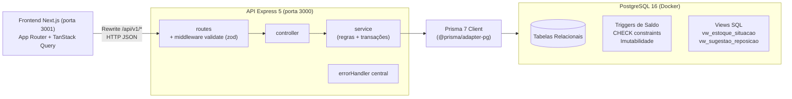
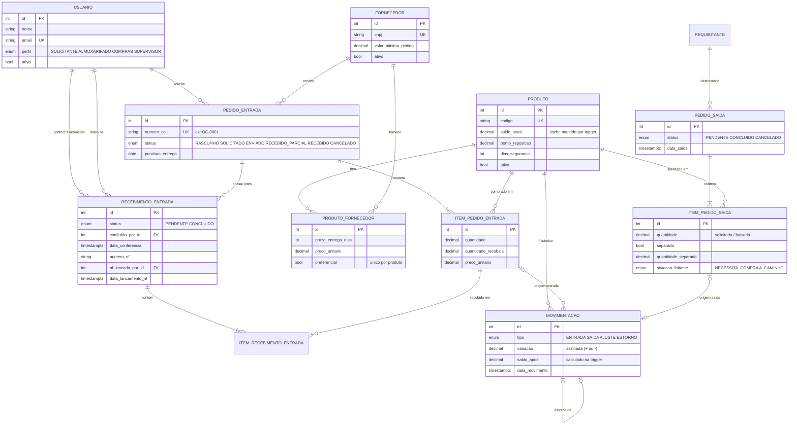
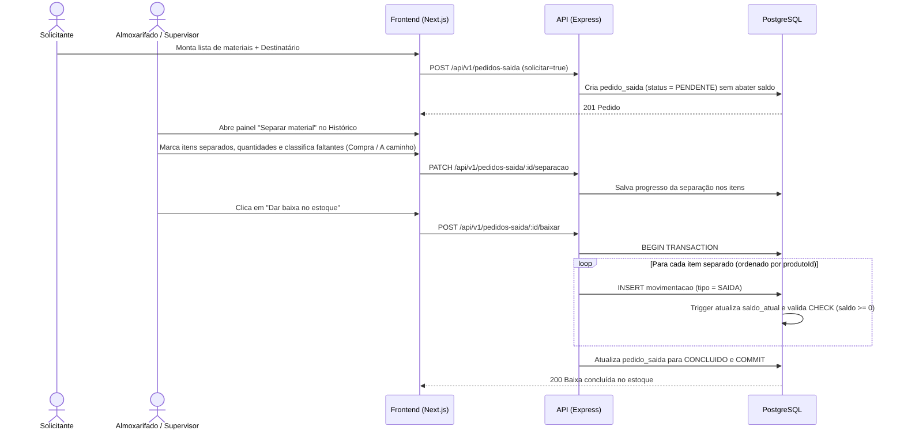
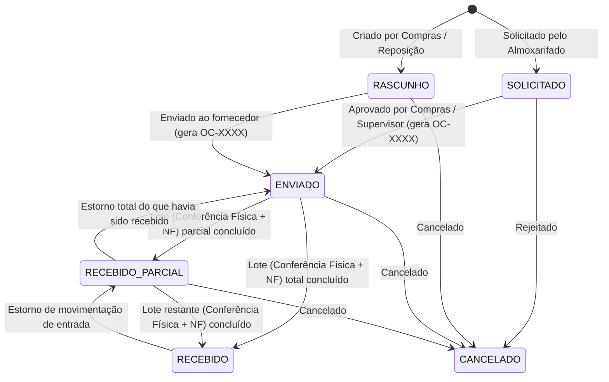

# Arquitetura — Sistema de Controle de Estoque e Reposição Inteligente

> Este documento explica **o que o sistema é e por que foi desenhado assim**.  
> O histórico detalhado de uso da IA (prompts, iterações e decisões de engenharia) está em [`DOCUMENTACAO_IA.md`](../DOCUMENTACAO_IA.md).  
> Os diagramas utilizam [Mermaid](https://mermaid.js.org/), renderizado nativamente pelo GitHub.

---

## 1. Visão geral

Sistema web full-stack de controle de estoque para **almoxarifado técnico e industrial**, contemplando catálogo de produtos, gestão de fornecedores (com vínculo N:N de prazos e preços), controle de acesso baseado em 4 perfis (`SOLICITANTE`, `ALMOXARIFADO`, `COMPRAS` e `SUPERVISOR`), fluxo completo de compras (solicitação, aprovação com emissão de Ordem de Compra e acompanhamento de atrasos), recebimento em duas etapas (conferência física por OC + lançamento de Nota Fiscal), solicitações de retirada com painel de separação detalhada no almoxarifado e livro-razão imutável de movimentações.

### Diferenciais implementados

1. **Reposição inteligente (*"O que comprar hoje"*):** Em vez de depender apenas de um ponto de reposição estático, uma *view* no PostgreSQL (`vw_sugestao_reposicao`) calcula o consumo médio diário dos últimos 30 dias, cruza com o prazo de entrega (*lead time*) de cada fornecedor e com a quantidade que já está a caminho em OCs emitidas, sugerindo automaticamente o que precisa ser comprado agrupado por fornecedor.
2. **Recebimento em 2 etapas (OC + NF):** Os materiais recebidos (total ou parcialmente) só incrementam o saldo do estoque quando **ambas** as custódias são confirmadas: a conferência física pelo `ALMOXARIFADO` e o lançamento da Nota Fiscal pelo setor de `COMPRAS` (ou `SUPERVISOR`).
3. **Fluxo de retirada com separação detalhada:** O perfil `SOLICITANTE` envia uma lista de materiais informando o destinatário (`PENDENTE`, sem abater o estoque de imediato). O `ALMOXARIFADO` confere a disponibilidade, marca quais itens e quantidades foram separados, classifica eventuais itens faltantes (`NECESSITA_COMPRA` ou `A_CAMINHO`) e efetiva a baixa transacional no estoque.

| Núcleo do Sistema | Diferenciais de Engenharia e UX |
|---|---|
| CRUD de produtos, fornecedores, requisitantes e usuários; pedidos de entrada e saída; saldo mantido por trigger no PostgreSQL | Reposição inteligente (`vw_sugestao_reposicao`); semáforo de estoque (`vw_estoque_situacao`); RBAC em 4 perfis; recebimento em 2 etapas (OC + NF); separação detalhada de retiradas; tema claro/escuro |

---

## 2. Stack tecnológica e execução local

| Camada | Tecnologia |
|---|---|
| **Frontend (`web/`)** | Next.js 16 (App Router), React 19, TypeScript, Tailwind CSS 4, `shadcn/ui`, `@tanstack/react-query`, `lucide-react`, `sonner` |
| **Backend (`back/`)** | Node.js 22.x–24.x, Express 5, TypeScript (`tsx` + `nodemon` em desenvolvimento) |
| **Validação** | `zod` (schemas estritos para `params`, `query` e `body`) |
| **ORM / Acesso a Dados** | Prisma ORM 7 com driver adapter `@prisma/adapter-pg` |
| **Banco de Dados** | PostgreSQL 16 (`postgres:16-alpine`) via Docker Compose |

**Versões obrigatórias das diretrizes:** Node.js entre `22.x` e `24.x`; PostgreSQL entre `15` e `16`.

### Subir o ambiente (resumo)

```bash
cp .env.example .env && cp back/.env.example back/.env
docker compose up -d
cd back && npm install && npx prisma migrate deploy && npm run seed && npm run dev
# Em outro terminal:
cd web && npm install && npm run dev
```

O `docker-compose.yml` fica na **raiz** do repositório. Os arquivos `.env` ficam fora do Git (ignorados no `.gitignore`), enquanto `.env.example` e `back/.env.example` são versionados com valores de exemplo.

---

## 3. Arquitetura em camadas



### Módulos do Backend (`back/src/modules/`)

Cada módulo segue a divisão `routes.ts` → `controller.ts` → `service.ts` → `schemas.ts`:

| Módulo | Responsabilidade |
|---|---|
| `auth` | Login por e-mail/senha, validação de credenciais e listagem rápida de perfis para demonstração |
| `usuarios` | CRUD administrativo de usuários exclusivo para o perfil `SUPERVISOR`, com proteção do último supervisor ativo |
| `produtos` | Catálogo de produtos, vínculo de fornecedores (`ProdutoFornecedor`) e histórico individual de movimentações |
| `fornecedores` / `cadastro-fornecedor` / `gestao-fornecedor` | Cadastro, edição, ativação/inativação e gerenciamento de produtos fornecidos, preços e *lead time* |
| `requisitantes` | Cadastro e listagem de destinatários/setores que retiram materiais |
| `pedidos-entrada` | Criação de rascunhos/solicitações, aprovação com geração de número de OC (`OC-0001`), lotes de recebimento em 2 etapas (conferência física + NF) e cancelamento |
| `acompanhamento` | Listagem unificada de solicitações e Ordens de Compra com filtros avançados (período, status, solicitante e pedidos em atraso) |
| `pedidos-saida` | Solicitações de retirada (`PENDENTE`), registro de separação detalhada item a item, baixa efetiva no estoque (`CONCLUIDO`), histórico paginado e cancelamento com estorno |
| `movimentacoes` | Consulta ao livro-razão, ajustes manuais de inventário (com motivo obrigatório) e estorno de movimentações |
| `estoque` | Situação consolidada do estoque (semáforo vermelho/amarelo/verde e dias sem saída via `vw_estoque_situacao`) |
| `reposicao` | Sugestões inteligentes de compra agrupadas por fornecedor (`vw_sugestao_reposicao`) e geração de rascunhos/solicitações |

---

## 4. Modelo de dados (Diagrama ER)



---

## 5. Decisões de arquitetura

### D1. O saldo é derivado de um livro-razão imutável de movimentações
- **Contexto:** O saldo físico precisa ser auditável e à prova de edições diretas acidentais.
- **Decisão:** Toda alteração de estoque nasce de uma linha na tabela `movimentacoes` (`ENTRADA`, `SAIDA`, `AJUSTE` ou `ESTORNO`). A coluna `produtos.saldo_atual` é um cache mantido exclusivamente por *trigger* no PostgreSQL. A API rejeita qualquer tentativa de enviar `saldoAtual` no corpo da requisição (`400 VALIDATION_ERROR`).
- **Alternativa descartada:** Campo `quantidade` editável diretamente no cadastro do produto.
- **Consequência:** Rastreabilidade completa (`saldo_apos` registrado em cada evento) e correções feitas exclusivamente por estorno.

### D2. Integridade garantida pelo banco de dados (`extras.sql`)
- **Contexto:** Regras críticas de estoque não podem depender apenas de `if` na camada de aplicação.
- **Decisão:**
  - **Trigger `BEFORE INSERT` em `movimentacoes`:** aplica a variação ao `saldo_atual` do produto e grava `saldo_apos`.
  - **Constraints `CHECK`:** impedem `saldo_atual < 0`, quantidades zero/negativas e sinais incoerentes com o tipo de movimentação.
  - **Bloqueio de `UPDATE`/`DELETE` em `movimentacoes`:** garante imutabilidade do livro-razão.
  - **Índice único parcial:** garante no máximo um fornecedor preferencial ativo por produto.
- **Consequência:** Mesmo sob requisições concorrentes, o PostgreSQL serializa o `UPDATE` na linha do produto e impede saldo negativo na origem.

### D3. Concorrência, prevenção de deadlock e transações
- **Contexto:** Duas baixas simultâneas com múltiplos itens podem disputar travas no banco.
- **Decisão:** Toda operação que gera movimentação executa dentro de `prisma.$transaction`, e os itens são sempre **ordenados por `produtoId` crescente** antes dos `INSERT`s em `movimentacoes`.
- **Consequência:** Elimina o risco de *deadlock* entre transações concorrentes e retorna `422 SALDO_INSUFICIENTE` detalhando exatamente quais itens faltaram.

### D4. Contrato padronizado da API REST
- Rotas versionadas em `/api/v1`, com validação estrita via `zod` (`res.locals.valid`).
- Transições de negócio modeladas como sub-recursos semânticos (`/enviar`, `/receber`, `/cancelar`, `/separacao`, `/baixar`, `/estornar`).
- Valores `Decimal` trafegam como `string` no JSON para evitar perda de precisão de ponto flutuante.
- Tratamento centralizado no `errorHandler.ts` com envelope único `{ error: { code, message, details } }`.

### D5. Reposição inteligente via View SQL (`vw_sugestao_reposicao`)
- **Contexto:** Pontos de reposição fixos ficam defasados quando o consumo muda ou quando os fornecedores possuem prazos de entrega distintos.
- **Decisão:** Concentrar a inteligência na view `vw_sugestao_reposicao`:
  - **Consumo médio diário:** saídas líquidas dos últimos 30 dias $\div 30$.
  - **Ponto de reposição sugerido:** $\text{consumo médio} \times (\text{prazo de entrega} + \text{dias de segurança})$.
  - **Saldo disponível projetado:** $\text{saldo atual} + \text{quantidade em trânsito (OCs enviadas)}$.
  - **Quantidade sugerida de compra:** cobre $\text{prazo} + \text{segurança} + 30\text{ dias}$, descontando o disponível.

### D6. Controle de Acesso Baseado em Perfis (RBAC)
- **Contexto:** Separar responsabilidades entre quem requisita material, quem opera o almoxarifado físico, quem negocia com fornecedores e quem supervisiona a operação.
- **Decisão:** Implementação de 4 perfis (`SOLICITANTE`, `ALMOXARIFADO`, `COMPRAS`, `SUPERVISOR`) validados tanto na navegação do frontend (`AppLayout` e `Nav`) quanto nas operações da API:
  - `SOLICITANTE`: restrito ao catálogo de produtos (`/produtos`) e envio de listas de retirada (`/saida`).
  - `ALMOXARIFADO`: executa a separação detalhada e baixa de retiradas, gera solicitações de reposição e realiza a conferência física de recebimento por OC.
  - `COMPRAS`: aprova solicitações de compra emitindo OCs, acompanha atrasos, lança Notas Fiscais no recebimento e gerencia fornecedores.
  - `SUPERVISOR`: acesso total a todas as telas operacionais mais o CRUD exclusivo de usuários (`/usuarios`).

### D7. Recebimento em 2 Etapas (Conferência Física por OC + Nota Fiscal)
- **Contexto:** No fluxo real de almoxarifado e compras, a chegada física das caixas na doca e o lançamento contábil da Nota Fiscal ocorrem em momentos e setores distintos, podendo haver entregas parciais da mesma Ordem de Compra.
- **Decisão:** Criar as entidades `RecebimentoEntrada` e `ItemRecebimentoEntrada`. Cada lote de recebimento registra os itens e quantidades parciais que chegaram e exige duas confirmações independentes:
  1. **Conferência Física** (`ALMOXARIFADO` ou `SUPERVISOR`);
  2. **Lançamento da NF** (`COMPRAS` ou `SUPERVISOR`).
- **Consequência:** O lote permanece `PENDENTE` até que ambas as etapas estejam preenchidas. Apenas no instante em que a segunda etapa é concluída o sistema gera as movimentações `ENTRADA`, incrementa `quantidade_recebida` no pedido e atualiza o status da OC para `RECEBIDO_PARCIAL` ou `RECEBIDO`.

### D8. Solicitação de Retirada e Separação Detalhada no Almoxarifado
- **Contexto:** O solicitante pede materiais para um destinatário, mas nem sempre todos os itens estão disponíveis na prateleira no momento da separação.
- **Decisão:**
  - Pedidos criados pelo `SOLICITANTE` nascem com status `PENDENTE` (sem gerar movimentação imediata).
  - Na fila de separação (`/saida`), o `ALMOXARIFADO` visualiza todos os itens pedidos, marca o que foi fisicamente separado (`separado`, `quantidade_separada`) e classifica o que faltou (`situacao_faltante`: `NECESSITA_COMPRA` ou `A_CAMINHO`).
  - Ao acionar **"Dar baixa no estoque"** (`POST /pedidos-saida/:id/baixar`), o sistema ajusta o pedido para as quantidades efetivamente separadas, gera as movimentações `SAIDA` de forma atômica e muda o status para `CONCLUIDO`.

### D9. Índices de performance no PostgreSQL
| Índice | Consulta otimizada |
|---|---|
| `(produto_id, tipo, data_movimento DESC)` | Cálculo do consumo médio de 30 dias, última entrada e última saída |
| `(produto_id, data_movimento DESC)` | Extrato paginado de movimentações de um produto |
| GIN `gin_trgm_ops` em `nome` e `codigo` | Busca rápida por texto/código de barras no balcão de saída |
| Índice parcial em produtos abaixo do ponto | Filtro de produtos críticos no semáforo de estoque |
| Índice único parcial em `produtos_fornecedores` | Garantia de único fornecedor preferencial por produto |
| BRIN em `data_movimento` | Varredura temporal compacta sobre histórico *append-only* |

---

## 6. Fluxos principais

### 6.1 Solicitação, Separação e Baixa de Material (Saída)



### 6.2 Ciclo de vida do Pedido de Entrada e Recebimento (OC + NF)



---

## 7. Limitações assumidas e evolução futura

| Decisão / Limitação | Estado Atual no Projeto | Evolução Futura Possível |
|---|---|---|
| **Local único de estoque** | Saldo controlado para um almoxarifado central | Adicionar entidade `LocalEstoque` (corredor/prateleira/filial) e saldo por endereço |
| **Autenticação e Perfis** | Implementado login com 4 perfis (`SOLICITANTE`, `ALMOXARIFADO`, `COMPRAS`, `SUPERVISOR`) e CRUD de usuários | Adicionar tokens JWT assinados com `httpOnly` cookies e recuperação de senha por e-mail |
| **Valor mínimo do fornecedor** | Exibido como alerta visual nas telas de Reposição e Pedidos/OC quando o pedido fica abaixo do mínimo | Bloqueio configurável ou sugestão automática de itens complementares do mesmo fornecedor |
| **Importação em lote** | Cadastro individual via interface e carga inicial via `prisma/seed.ts` | Importação de catálogo e notas fiscais via arquivo XML (NF-e) ou CSV |
| **Testes** | Validação por checagem estática (`tsc` + `eslint`) e roteiros de teste de ponta a ponta na API e interface | Suíte de testes automatizados de integração com Vitest / Supertest |
